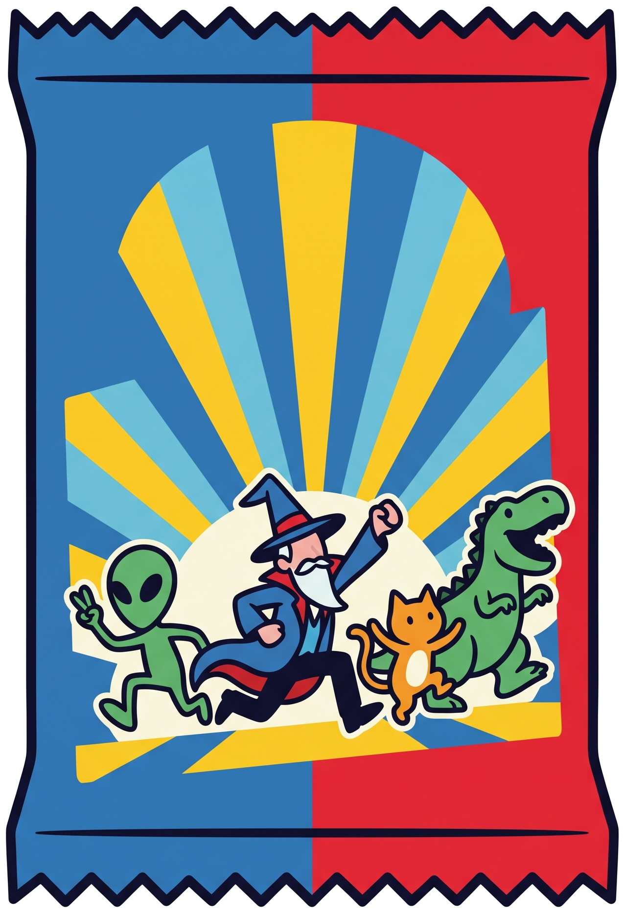

<p align="center">
  
</p>

<h1 align="center">Challengers Card Maker</h1>

<p align="center">
  <strong>Plataforma web <em>client-side</em> para la visualización, diseño, gestión y exportación para impresión (Print and Play) de cartas y expansiones personalizadas para el juego de mesa Challengers!.</strong>
</p>

<p align="center">
  <a href="https://kr43xpo.github.io/Challengers-Card-Maker/"></a>
  
  
  
  
</p>

<br>

Permite cargar paquetes personalizados en formato `.zip`, explorar colecciones con filtros dinámicos y renderizado multilingüe en tiempo real, ajustar el conteo de copias físicas por baraja y generar documentos PDF en formato A4 listos para corte o tiras de inserción para fundas opacas.

---

## 🛠️ Stack Tecnológico

| Capa | Tecnología | Propósito |
| :--- | :--- | :--- |
| **Core Frontend** | HTML5 semántico + Vanilla JavaScript (ES6+ modular) | Lógica de la aplicación, estado reactivo en memoria y manipulación del DOM sin dependencias de frameworks pesados. |
| **Estilos** | Vanilla CSS3 (Custom Properties, Grid, Flexbox) | Sistema de diseño modular, adaptabilidad responsive y transiciones aceleradas por GPU (transformaciones 3D). |
| **Descompresión en cliente** | [JSZip v3.10.1](https://stuk.github.io/jszip/) | Lectura, parsing y extracción en memoria de archivos `.zip` sin subida a servidor externo. |
| **Almacenamiento local** | IndexedDB API | Persistencia de mazos cargados, imágenes e ilustraciones en el navegador del usuario. |
| **Generación de PDF** | [jsPDF v2.5.1](https://github.com/parallax/jsPDF) | Construcción vectorial de documentos A4 y ensamblaje de pliegos de impresión. |
| **Rasterización de plantillas** | [html2canvas v1.4.1](https://html2canvas.hertzen.com/) | Renderizado de cartas a lienzo gráfico de alta resolución (2x DPI) para inserción en PDF. |
| **Tooling & CLI** | Python 3.10+ | Servidor de desarrollo local (`server.py`) y suite de validación/empaquetado de mazos (`crearMazo/`). |

---

## 🚀 Prerrequisitos e Instalación

La aplicación es 100% estática y puede ejecutarse directamente en cualquier navegador moderno o alojarse en servicios como **GitHub Pages**.

### Requisitos
- Navegador web compatible con ES6 e IndexedDB (Chrome 90+, Firefox 88+, Safari 14+, Edge 90+).
- Python 3.8+ (únicamente para levantar el entorno de desarrollo local).

### Pasos para ejecución local

1. Clonar el repositorio:
```bash
git clone https://github.com/kr43xpo/Challengers-Card-Maker.git
cd Challengers-Card-Maker
```

2. Iniciar el servidor local:
```bash
# Opción A: Mediante el script automatizado
python server.py

# Opción B: Mediante el módulo nativo de Python
python -m http.server 8000
```

3. Abrir en el navegador:
```text
http://localhost:8000
```

---

## 📦 Estructura del Archivo ZIP

Para que el parser del cliente (`loadZipPackage`) reconozca e importe un mazo personalizado sin errores, el archivo `.zip` debe estructurarse del siguiente modo:

```text
mi_expansion.zip
├── cards.json                 # Base de datos obligatoria con la definición de cartas y facciones
├── deck_info.json             # (Opcional) Metadatos del pack (título, autor, balance y reglas)
└── images/
    ├── art_digital/           # Ilustraciones principales de las cartas
    │   ├── carta_01.jpg
    │   ├── carta_02.png
    │   └── carta_03.webp
    └── icons/                 # Iconos vectoriales o mapas de bits de cada facción
        ├── icon_faccion_1.png
        └── icon_faccion_2.png
```

### Reglas de Nomenclatura y Enlace
1. **Base de datos**: El archivo principal debe llamarse estrictamente `cards.json` (o ubicarse en la raíz del `.zip` con extensión `.json`).
2. **Ilustraciones**: Los archivos referenciados en `art_image` pueden estar en formato `.jpg`, `.jpeg`, `.png`, `.webp`, `.svg` o `.gif`. El parser resuelve el archivo tanto si se especifica la ruta relativa (`images/art_digital/esbirro.jpg`) como si se especifica únicamente el nombre del archivo (`esbirro.jpg`).
3. **Iconos de Facción**: Referenciados en `icon_path` dentro de cada objeto de facción o carta.

### Esquema del archivo `cards.json`

```json
{
  "version": "1.0",
  "title": "Challengers! - Expansión Dioses",
  "creator": "kr43xpo",
  "collection": "Edición Dioses",
  "description": "Expansión temática con deidades y figuras de mitologías mundiales.",
  "sets": {
    "pantheon_egypt": {
      "id": "pantheon_egypt",
      "name": {
        "es": "Panteón Egipcio (Duat)",
        "en": "Egyptian Pantheon (Duat)",
        "fr": "Panthéon Égyptien (Douat)"
      },
      "color_hex": "#d97706",
      "color_border": "#f59e0b",
      "icon_path": "icon_dioses_egipcios.png",
      "base_set": "Bosque Mágico (Challengers! 2)"
    }
  },
  "cards": [
    {
      "id": 101,
      "set_id": "pantheon_egypt",
      "level": "A",
      "strength": "2",
      "default_copies": 5,
      "art_image": "anubis.jpg",
      "icon_path": "icon_dioses_egipcios.png",
      "es": {
        "name": "Anubis",
        "text": "Al ser colocado: Elige una carta de tu banquillo y devuélvela al mazo."
      },
      "en": {
        "name": "Anubis",
        "text": "When placed: Choose a card from your bench and return it to your deck."
      },
      "fr": {
        "name": "Anubis",
        "text": "Lorsqu'il est placé: Choisissez une carte de votre banc et remettez-la dans votre deck."
      }
    }
  ]
}
```

### Campos Clave
- `level`: Identificador de fase o nivel: `"S"` (Inicial), `"A"`, `"B"`, `"C"`, `"Entraîneur"` / `"Trainer"` (Entrenadores) o `"R"` (Robot).
- `strength`: Fuerza base de la carta (`1` al `10`, `"?"` o `"∞"`).
- `default_copies`: Número de copias físicas de la carta incluidas en el mazo global.
- `set_id`: Clave de la facción definida en el bloque `sets`.

---

## 🖨️ Especificaciones de Impresión (PDF)

El motor de exportación (`exportPDF`) compila pliegos de cartas listos para impresión casera (PnP) o corte en guillotina bajo estándares de imprenta:

| Parámetro | Valor de Especificación |
| :--- | :--- |
| **Soporte de Hoja** | Formato estándar **A4** (210 × 297 mm, orientación vertical). |
| **Tamaño de Carta Estándar** | **63.5 × 88.0 mm** (Estándar TCG / Poker 2.5" × 3.5"). Compatible con fundas estándar (Magic, Pokémon). |
| **Distribución de Cuadrícula** | Cuadrícula de **3 × 3 cartas por hoja** (9 cartas por página A4). |
| **Márgenes de Página** | Margen horizontal: `9.75 mm` centrado (`(210 - (3 × 63.5)) / 2`).<br>Margen vertical: `16.50 mm` centrado (`(297 - (3 × 88.0)) / 2`). |
| **Sangrado y Bordes (Bleed)** | Margen blanco perimetral configurable por el usuario (predeterminado `4.0 mm`), o modo corte al ras sin marco blanco. |
| **Guías de Corte** | Marcas de corte recto impresas perimetralmente para guillotina o regla y cúter. |

### Modos de Exportación Disponibles
1. **Plantilla Traducida / Vectorial**: Renderizado completo de la carta con cabecera, caja de habilidad, valores de fuerza, iconos y textos vectoriales en el idioma seleccionado.
2. **Digital Original**: Ilustración recortada en alta definición respetando el encuadre digital nativo.
3. **Tiras para Fundas (Sleeve Strips)**: 27 tiras por hoja A4 (cuadrícula 3 × 9 de `63.5 × 27.5 mm`). Diseñadas para deslizarse dentro de fundas opacas sobre cartas genéricas, logrando el máximo ahorro de tinta.
4. **Portada y Resumen Oficial A4**: Ficha de referencia con estadísticas del pack, autoría, reglas de balance y tabla de desglose (`NIVEL | DISTRIBUCIÓN | CARTAS`).
   - Mazos estándar (≤ 6 facciones): Portada en 1 sola hoja A4.
   - Mazos extendidos (> 6 facciones): Portada paginada automáticamente en 2 hojas A4.
   - **Regla estricta de maquetación**: Las páginas de cartas siempre inician forzosamente en una hoja nueva tras la portada.

---

## 🔄 Flujo de Uso e Interfaz

```text
[ Cargar .ZIP ]  ──>  [ Descompresión en Memoria ]  ──>  [ Renderizado de Galería ]
       │                                                         │
       ├── Catálogo de expansiones integradas                    ├── Búsqueda por texto y palabra clave
       └── Arrastre local de archivos ZIP                        ├── Filtrado por Facción, Nivel y Fuerza
                                                                 ├── Volteo dinámico de cartas 3D
                                                                 └── Selector de idioma (ES / EN / FR)
                                                                         │
                                                                         ▼
                                                              [ Modal de Exportación ]
                                                                         │
                                                                         ├── Ajuste individual de copias
                                                                         ├── Configuración de márgenes
                                                                         ├── Selección de Portada A4
                                                                         └── Descarga PDF / ZIP de imágenes
```

- **Simulación de sobres (Booster Packs)**: Durante la descompresión y apertura de mazos, la interfaz presenta una animación de sobre flotante con feedback en tiempo real del progreso porcentual y extracción de imágenes.
- **Renderizado 3D Interactivo**: Cada carta reacciona dinámicamente al cursor y cuenta con animación de volteo para alternar entre el anverso (arte y reglas) y el reverso oficial del juego o del robot.

---

## 🏛️ Arquitectura del Proyecto

### Estructura de Directorios

```text
Challengers-Card-Maker/
├── index.html                 # Punto de entrada HTML5 y estructura semántica de modales
├── app.js                     # Controlador principal: estado, catálogo, parsing ZIP y exportación
├── style.css                  # Hoja de estilos principal, maquetación A4 y reglas de impresión
├── favicon.png                # Favicon del visor
├── jszip.min.js               # Librería cliente para extracción ZIP
├── jspdf.umd.min.js           # Librería cliente para generación de PDF
├── html2canvas.min.js         # Motor de rasterizado DOM a Canvas
├── images/
│   ├── deck_logo.png          # Logotipo temático del paquete de cartas
│   ├── card_back.jpg          # Reverso estándar oficial de las cartas
│   ├── card_back_robot.jpg    # Reverso oficial para cartas del mazo Robot
│   └── icons/                 # Iconos de torneos de jugadores (player_icon_*.png)
├── decks/                     # Expansiones comunitarias y plantillas descargables (.zip y .json)
├── decks-oficial/             # (Ignorado en Git) Mazos con derechos oficiales de Challengers!
├── crearMazo/                 # Suite de herramientas para autores de expansiones
│   ├── README.md              # Documentación de reglas de balance 1:1
│   ├── crear_mazo.py          # Script CLI interactivo para generar y empaquetar mazos
│   ├── catalogo_facciones.json# Base de datos canónica de facciones oficiales y sus curvas de poder
│   └── plantilla_deck.json    # Plantilla JSON vacía para nuevos mazos
├── .gitignore                 # Exclusiones de Git (decks-oficial/, backups, temporales)
└── README.md                  # Documentación técnica del proyecto
```

### Pipeline de Datos

```text
1. Entrada:
   Input File / Fetch  ──>  ArrayBuffer en memoria del navegador.

2. Descompresión & Parsing:
   JSZip.loadAsync()   ──>  Extracción de cards.json  ──> JSON.parse()
                       ──>  Extracción de imágenes   ──> Map<string, BlobURL>

3. Normalización y Estado:
   Normalizador        ──>  Homogeneización de estructura (sets, cards, levels, copies).
                       ──>  Almacenamiento en variables de estado reactivo y caché IndexedDB.

4. Renderizado en DOM:
   Generador de Nodos  ──>  Inyección de tarjetas .card-item en .cards-grid.
                       ──>  Asociación de BlobURLs a elementos  sin llamadas de red.

5. Pipeline de Salida (PDF / Print):
   Cálculo de Pliegos  ──>  Agrupación de cartas en lotes de 9 por página A4.
   html2canvas         ──>  Renderizado off-screen de cada pliego a Canvas (2x scale).
   jsPDF               ──>  Compilación de pliegos rasterizados + páginas de portada resumen.
   Salida              ──>  Descarga directa de archivo .pdf mediante Blob.
```

---

## 🔗 Referencias y Enlaces Oficiales

- 🌐 [Página Oficial de Challengers! (Next Move Games)](https://www.nextmove-games.com/en/challengers/)
- 🎲 [Challengers! (2022) en BoardGameGeek](https://boardgamegeek.com/boardgame/359970/challengers)
- 🏖️ [Challengers! Beach Cup (2023) en BoardGameGeek](https://boardgamegeek.com/boardgame/390340/challengers-beach-cup)

---

## 📄 Licencia y Derechos

Este proyecto es una herramienta de código abierto desarrollada sin ánimo de lucro por la comunidad de jugadores.

- *Challengers!* es una marca registrada y propiedad intelectual de sus respectivos autores (Johannes Krenner, Markus Slawitscheck) y editoriales (1 More Games / Z-Man Games / Next Move Games).
- Este repositorio no incluye en su control de versiones archivos, ilustraciones ni material protegido por derechos editoriales de los juegos base oficiales.

